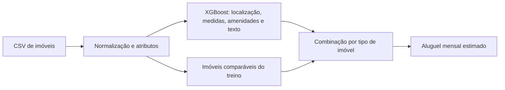
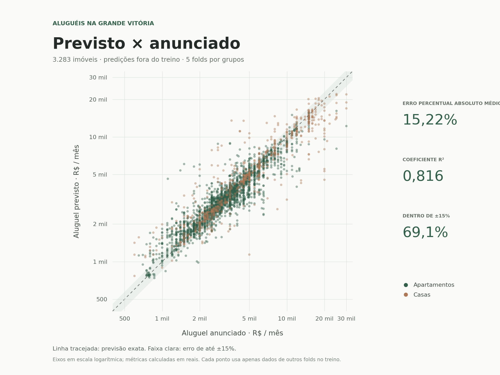

# Previsão de aluguéis na Grande Vitória

Modelo de aprendizado de máquina para estimar o **aluguel mensal residencial** de casas e apartamentos na Região Metropolitana da Grande Vitória, Espírito Santo. Projeto desenvolvido na disciplina de Inteligência Artificial da Universidade Federal do Espírito Santo (UFES).

O trabalho obteve o **melhor desempenho da turma na avaliação da disciplina**. Na preparação desta versão, a validação interna em cinco folds registrou **MAPE de 15,22%**. São resultados de avaliações distintas: a pontuação do conjunto externo da disciplina não é publicada neste repositório.

> **English:** A residential rent prediction project for Greater Vitória, Brazil, combining XGBoost with comparable properties. Includes a trained CPU model, a CSV inference CLI, synthetic examples, and grouped cross-validation results.

## Executar uma previsão

Requer **Python 3.12**. Não é necessário coletar anúncios ou treinar novamente para usar o modelo incluído.

```bash
git clone https://github.com/gabrieldealbuquerque/previsao-alugueis-grande-vitoria.git
cd previsao-alugueis-grande-vitoria
python3.12 -m venv .venv
source .venv/bin/activate
python -m pip install -r requirements.txt
python inferencia.py --input examples/entrada.csv --output resultado.csv
```

No Windows, crie o ambiente com `py -3.12 -m venv .venv` e ative-o com `.venv\Scripts\Activate.ps1` no PowerShell. As versões das dependências estão fixadas para carregar o artefato treinado.

O [exemplo de entrada](examples/entrada.csv) contém três imóveis **fictícios**. A execução gera:

```csv
id,valor_previsto
exemplo_01,2951
exemplo_02,7242
exemplo_03,4223
```

`valor_previsto` é o aluguel mensal estimado em reais, arredondado para inteiro, **sem somar condomínio e IPTU**. A [saída de referência](examples/saida.csv) permite conferir o exemplo. Sem argumentos, `python inferencia.py` usa a mesma entrada e grava `resultado.csv` na raiz.

### Seu próprio CSV

Use UTF-8, vírgula como separador e ponto para casas decimais. Não inclua `preco_aluguel` para fazer previsões.

| Campo | Conteúdo |
| --- | --- |
| `id` | Identificador preservado na saída; se ausente, o programa gera `amostra_1`, `amostra_2`… |
| `cidade`, `bairro`, `tipo` | Localização e tipo; use `Casa` ou `Apartamento`. |
| `area_m2`, `quartos`, `banheiros`, `suites`, `vagas` | Área útil em m² e quantidades. |
| `condominio`, `iptu` | Valores informados no anúncio, em reais; são atributos de entrada. |
| `rua`, `andar`, `area_total_m2`, `area_construida_m2`, `area_terreno_m2` | Detalhes opcionais do imóvel. |
| `descricao` | Texto opcional, usado para extrair características e representar o anúncio. |
| `mobiliado`, `elevador`, `piscina`, `varanda` e outras amenidades | Campos opcionais; aceitam `sim`/`nao` ou `1`/`0`. |

Campos ausentes passam pelo tratamento de faltantes. Para uma estimativa útil, informe ao menos cidade, bairro, tipo, área, quartos, banheiros e vagas. A CLI não rejeita automaticamente imóveis fora do domínio; a adequação da entrada deve ser verificada por quem a utiliza. O contrato completo está em [`MODEL_INPUT_COLUMNS`](src/preprocessamento.py).

## Como funciona



O pipeline cria **85 atributos de entrada**, combina variáveis numéricas, categorias e TF-IDF e treina o XGBoost com transformação do alvo e ponderação dos exemplos. Na previsão, comparáveis de casas e apartamentos complementam o modelo global. A [documentação do modelo](docs/modelo.md) detalha as transformações, os pesos e a validação por grupos de imóveis.

## Resultados e validação

A avaliação usa previsões *out-of-fold* (OOF) em **3.283 registros**, após tratamento de uma base de **3.369 registros**. Para esta publicação, os cinco folds foram reexecutados em CPU, preservando as divisões históricas por grupos de imóveis. Cada imóvel foi previsto por um modelo ajustado somente nos outros quatro folds.

| Métrica | OOF reexecutado nesta publicação | OOF histórico do artefato |
| --- | ---: | ---: |
| MAPE — erro percentual absoluto médio | **15,22%** | 15,31% |
| MdAPE — erro percentual absoluto mediano | 8,54% | 8,52% |
| MAE — erro absoluto médio | R$ 670,28 | R$ 675,75 |
| RMSE — raiz do erro quadrático médio | R$ 1.497,99 | R$ 1.507,71 |
| R² | 0,816 | 0,814 |
| Previsões com erro absoluto percentual de até 15% | 69,08% | 68,53% |



A linha tracejada representa a previsão exata; a faixa clara marca erro de até ±15%. Os eixos usam escala logarítmica para mostrar as diferentes faixas de aluguel. [Versão vetorial do gráfico](docs/assets/predicoes-oof.svg).

As métricas da nova execução estão em [`reports/oof-metrics.json`](reports/oof-metrics.json), com [valores anunciados e previstos anonimizados](reports/oof-predictions.csv). Os metadados históricos permanecem em [`reports/metrics.json`](reports/metrics.json). Nenhum novo modelo final foi ajustado: a CLI continua usando o artefato acadêmico preservado.

Na preparação do artefato público, suas previsões também foram comparadas às do modelo original nos 3.283 registros de referência, com diferença absoluta máxima igual a zero. Essa conferência verifica a preservação do artefato e é separada da validação OOF.

## Estrutura e reprodução

```text
├── inferencia.py             # CSV de entrada → CSV de previsões
├── train.py                  # Validação em cinco folds e treinamento final
├── modelo_aluguel.joblib     # Modelo treinado, pronto para CPU
├── src/                      # Qualidade, atributos, estimadores e validação
├── scrapers/                 # Coletores usados no trabalho acadêmico
├── examples/                 # Entrada fictícia e saída correspondente
├── reports/                  # Métricas históricas, OOF reexecutado e hash
└── docs/                     # Modelo, dados e coleta
```

O conjunto de anúncios, arquivos de avaliação da disciplina e histórico do repositório acadêmico privado não são distribuídos. Para treinar, é necessário fornecer uma base própria validada; os exemplos fictícios servem somente para demonstrar a inferência.

```bash
python train.py --help
python train.py --dataset dados/processados/minha_base.csv
```

Leia [modelo e reprodução](docs/modelo.md) e [coleta e qualidade dos dados](docs/coleta.md) antes de montar uma nova base. Os coletores são código histórico: a publicação não confirma compatibilidade atual com os portais.

## Limites e próximos passos

- O alvo é o preço **anunciado**, que pode diferir do aluguel efetivamente negociado.
- O domínio é residencial mensal na Grande Vitória: Vitória, Vila Velha, Serra, Cariacica, Viana, Guarapari e Fundão. A presença dessas cidades no pipeline não implica desempenho uniforme entre elas.
- A validação por grupos reduz a sobreposição de imóveis semelhantes entre folds, mas não substitui uma avaliação temporal ou um conjunto externo independente.
- Mudanças de mercado, bairros pouco representados, imóveis atípicos e entradas incompletas podem aumentar o erro. Não há intervalo de confiança por imóvel.
- Próximos passos: atualizar a base com dados autorizados, avaliar períodos futuros e erros por cidade/tipo/faixa de preço, e estimar incerteza das previsões.

## Autores

**Gabriel de Albuquerque Santos · Tiago Machado dos Santos · Victor Dutra de Jesus**

Projeto acadêmico da UFES. Os créditos do trabalho em grupo são preservados nesta versão pública.
